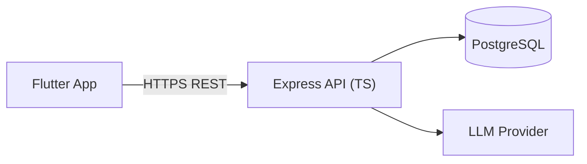

# 🚀 ARUS — Rencana Pengerjaan Step-by-Step per Milestone

> **Ringkasan Proyek:** ARUS adalah **mobile business decision-support system** (Flutter + Node.js/Express/TS + PostgreSQL) yang mengubah data transaksi menjadi analytics, insights, dan rekomendasi AI untuk bisnis multi-outlet F&B/retail.

> [!IMPORTANT]
> **Aturan utama:** Ikuti urutan milestone 1 → 10 (Core), lalu Gate G1, baru 11 → 19 (Supporting). Core **tidak boleh** dipotong. Supporting bisa dipotong jika waktu mepet.

---

## 📊 Gambaran Besar Arsitektur

**Stack:** Flutter + Riverpod + go_router + dio | Node.js 20 + Express + TypeScript + Prisma + zod | PostgreSQL 15+

---

## FASE 1: CORE CHAIN (Milestone 1–10)

> Harus selesai semua sebelum lanjut ke Supporting features.

---

### 🏗️ Milestone 1 — Project Setup & Decisions
**Tujuan:** Fondasi proyek, semua keputusan teknis ditutup.

| # | Step | Detail |
|---|------|--------|
| 1 | Buat monorepo | Struktur `/app` (Flutter), `/api` (backend), `/docs/ARUS_SRS.md` |
| 2 | Setup Flutter project | `arus_app/` dengan feature-first structure, pasang dependencies (riverpod, go_router, dio, dll) |
| 3 | Setup backend project | `arus_api/` dengan Express + TypeScript, pasang dependencies (zod, prisma, argon2, pino, dll) |
| 4 | Konfigurasi environment | `.env.example`, `--dart-define` untuk Flutter, feature flags |
| 5 | Setup core Flutter | `ApiClient` (dio + interceptors), `AppException`, `AppTheme` (Material 3), router shell, `strings_id.dart` |
| 6 | Setup core backend | `app.ts`, middleware chain (error handler, request ID, CORS, helmet, rate limit), `/health` endpoint |
| 7 | Provisioning database | PostgreSQL (Supabase/Neon sebagai plain Postgres) — **tutup D3** |
| 8 | CI/CD setup | Lint + test automation (GitHub Actions) |
| 9 | Tutup keputusan | D1 (json_serializable), D2 (openapi.yaml manual), D3, D4, D5, D8 |

**✅ Exit:** App Flutter memanggil `/health` di physical device dan dapat response.

---

### 🗄️ Milestone 2 — Database & Seed
**Tujuan:** Seluruh skema database siap + data demo.

| # | Step | Detail |
|---|------|--------|
| 1 | Buat Prisma schema | 21 tabel sesuai Section 5 (users, outlets, products, inventory, transactions, dll) |
| 2 | Generate migrations | `npx prisma migrate dev` |
| 3 | Buat seed script | Users (owner/manager/staff), ≥ 3 outlet + 1 London, 40 products, 90 hari transactions |
| 4 | Validasi constraints | CHECK (quantity >= 0), UNIQUE keys, FK indexes, trigram indexes |
| 5 | Test idempotency | Seed script bisa dijalankan berulang tanpa error |

**✅ Exit:** Migrations apply di DB kosong; seed idempotent.

---

### 🔐 Milestone 3 — Authentication & RBAC
**Tujuan:** Login, JWT, refresh token rotation, role-based access.

| # | Step | Detail |
|---|------|--------|
| 1 | **Backend:** Auth service | Login (argon2id verify), JWT access (15 min) + opaque refresh (7 days, rotating), logout |
| 2 | **Backend:** Refresh rotation | Single-use refresh tokens, family revocation (BR-AUTH-02), 5-login lockout |
| 3 | **Backend:** Auth middleware | `requireAuth`, `requireRole([...])`, `scopeOutlets(user)` |
| 4 | **Backend:** User management API | `GET/POST/PATCH /users` (Owner only) |
| 5 | **Backend:** `/auth/me`, `/auth/change-password` | Profile + password change |
| 6 | **Flutter:** Login screen (SC02) | Email + password form, error handling |
| 7 | **Flutter:** Splash screen (SC01) | Check secure storage, auto-refresh, warm-up |
| 8 | **Flutter:** Session management | Secure storage, dio interceptor (auto-refresh on 401), logout |
| 9 | **Flutter:** Role-based shell | Bottom nav berbeda per role (Owner/Manager vs Staff) |
| 10 | **Tests:** | T-AUTH-01..06, T-RBAC-01..06 |

**✅ Exit:** Login works, token rotation works, role-based nav works.

---

### 📦 Milestone 4 — Catalog
**Tujuan:** CRUD products & categories.

| # | Step | Detail |
|---|------|--------|
| 1 | **Backend:** Categories API | `GET/POST/PATCH /categories` |
| 2 | **Backend:** Products API | `GET/POST/PATCH /products` dengan search (ILIKE + trigram), filter, pagination |
| 3 | **Backend:** Business rules | SKU unique, soft-delete (deactivate), cost_idr hidden dari Staff |
| 4 | **Flutter:** Product List (SC12) | Search, category filter, active toggle, price display |
| 5 | **Flutter:** Product Detail (SC13) | Info + per-outlet stock |
| 6 | **Flutter:** Product Form (SC14) | Create/edit product |
| 7 | **Tests:** | T-CAT-01..03 |

**✅ Exit:** Products CRUD berjalan dengan validasi.

---

### 📊 Milestone 5 — Inventory
**Tujuan:** Stock tracking per outlet-product, movement log, adjustments.

| # | Step | Detail |
|---|------|--------|
| 1 | **Backend:** Inventory API | `GET /inventory`, filter by status (low/out/ok), days-of-cover |
| 2 | **Backend:** Adjustments | `POST /inventory/adjustments` (restock/correction/waste), row locks |
| 3 | **Backend:** Movement history | `GET /inventory/movements` dengan filters |
| 4 | **Backend:** Reorder level | `PATCH /inventory/:o/:p` |
| 5 | **Flutter:** Inventory List (SC15) | Outlet selector, status filter, days-of-cover chip |
| 6 | **Flutter:** Inventory Detail (SC16) | Stock info + movement history |
| 7 | **Flutter:** Stock Adjustment (SC17) | Bottom sheet: type, qty, note |
| 8 | **Tests:** | T-INV-01..05 (termasuk concurrent access test) |

**✅ Exit:** Stock management + movement audit trail works.

---

### 🛒 Milestone 6 — POS & Transactions
**Tujuan:** Atomic, idempotent sales. **INI MILESTONE PALING KRITIS.**

| # | Step | Detail |
|---|------|--------|
| 1 | **Backend:** `POST /transactions` | Atomic DB transaction: validate → lock stock → insert header+items → deduct stock → insert movements → (insert blockchain record if FEATURE_INTEGRITY) → commit |
| 2 | **Backend:** Idempotency | `client_request_id` UNIQUE — replay returns original |
| 3 | **Backend:** Server-side calculation | Server recomputes prices, totals, change (BR-POS-01) |
| 4 | **Backend:** Transaction list/detail | `GET /transactions`, `GET /transactions/:id` with scope filtering |
| 5 | **Backend:** Void | `POST /transactions/:id/void` — status change, stock return, void chain record |
| 6 | **Backend:** Receipt number | Format `TRX-<outletCode>-<yyyymmdd>-<seq>` |
| 7 | **Flutter:** POS screen (SC07) | Product grid + search, category chips, stock badge, cart FAB |
| 8 | **Flutter:** Cart & Checkout (SC08) | Line items, qty stepper, discount, payment method, paid amount, confirm |
| 9 | **Flutter:** Receipt (SC09) | Receipt display, integrity badge (if enabled) |
| 10 | **Flutter:** Transaction List/Detail (SC10, SC11) | Search, filters, void button |
| 11 | **Tests:** | T-POS-01..07 (idempotency, atomicity, insufficient stock, inactive product) |

> [!CAUTION]
> **Pair programming disarankan** di milestone ini. Atomicity dan idempotency harus benar — ini fondasi seluruh analytics.

**✅ Exit:** Sale works end-to-end, stock deducted atomically, receipt displayed.

---

### 📈 Milestone 7 — Analytics & Dashboard
**Tujuan:** KPI SQL queries, dashboard, charts.

| # | Step | Detail |
|---|------|--------|
| 1 | **Backend:** KPI SQL queries | 20+ KPIs (S1-S9, P1-P5, I1-I5, O1-O4) — raw SQL via `$queryRaw` |
| 2 | **Backend:** Analytics endpoints | `/analytics/overview`, `/sales`, `/products`, `/inventory`, `/outlets`, `/peak-hours`, `/compare`, `/shift` |
| 3 | **Backend:** Period handling | Outlet-timezone day buckets, previous period comparison, delta % |
| 4 | **Flutter:** Dashboard (SC04) | KPI cards, 7-day trend chart (fl_chart), top insights strip, inventory alert |
| 5 | **Flutter:** Staff Shift Summary (SC05) | Today's txn count, revenue, last 5 txn |
| 6 | **Flutter:** Analytics screen (SC18) | Tabs: Penjualan/Produk/Stok/Outlet/Jam Ramai, period selector, compare toggle |
| 7 | **Tests:** | T-ANA-01..07 (exact values dari fixtures, voided excluded, timezone buckets) |

**✅ Exit:** Dashboard loads ≤ 3s with 10k transactions; KPI values match fixtures.

---

### 💡 Milestone 8 — Decision Support
**Tujuan:** Rule engine menghasilkan insights otomatis.

| # | Step | Detail |
|---|------|--------|
| 1 | **Backend:** Rule engine | 8 rules: R1 LOW_STOCK, R2 RESTOCK_URGENT, R3 SALES_DECLINE, R4 SLOW_MOVING, R5 SALES_PEAK, R6 TARGET_ACHIEVED, R7 OUTLET_GAP, R8 PROMO_CANDIDATE |
| 2 | **Backend:** Scheduler | node-cron daily 05:00 WIB + on-demand via `POST /insights/generate` |
| 3 | **Backend:** Evidence storage | Setiap insight simpan `evidence` JSON (angka yang dipakai) |
| 4 | **Backend:** Dedup | Unique key (rule_code, outlet, product, date) |
| 5 | **Backend:** Insights API | `GET/PATCH /insights` (acknowledge/dismiss) |
| 6 | **Flutter:** Insights screen (SC19) | Severity filter, insight cards, evidence panel, acknowledge/dismiss |
| 7 | **Tests:** | T-DS-01..03 (each rule triggered, no duplicates, <14 days skipped) |

**✅ Exit:** Rules generate insights from real data; insights displayed with evidence.

---

### 🤖 Milestone 9 — AI Assistant
**Tujuan:** LLM-powered Q&A with hallucination prevention.

| # | Step | Detail |
|---|------|--------|
| 1 | **Backend:** Intent classifier | Rule-based (keyword/regex) untuk 9 intents + OUT_OF_SCOPE |
| 2 | **Backend:** Period parser | "hari ini", "minggu lalu", dll → date range |
| 3 | **Backend:** Retriever | Allow-listed query functions per intent (reuse analytics/insight services) |
| 4 | **Backend:** Fact builder | Structured facts JSON (≤ 40 facts, capped rankings) |
| 5 | **Backend:** LlmClient interface | Adapter for Gemini (default) + Anthropic |
| 6 | **Backend:** System prompt | Section 8.4 canonical text |
| 7 | **Backend:** Response validator | Schema check, fact_ids exist, number grounding, entity scope |
| 8 | **Backend:** Fallback | Deterministic template answer from facts when LLM fails |
| 9 | **Backend:** Conversations API | `POST /ai/chat`, `GET /ai/conversations`, `DELETE` |
| 10 | **Backend:** Caching | 5-min cache keyed by (scope, intent, period, data_version) |
| 11 | **Flutter:** AI Home (SC20) | Suggested questions, recent conversations |
| 12 | **Flutter:** AI Conversation (SC21) | Chat bubbles, Data/Dugaan/Saran cards, fallback banner |
| 13 | **Tests:** | T-AI-01..09 (8 intents, hallucination rejection, fallback, out-of-scope, rate limit, 30-prompt eval) |

**✅ Exit:** AI answers cite real numbers; 0 fabricated figures in test set.

---

### 📄 Milestone 10 — Reports
**Tujuan:** Immutable, hashed report snapshots.

| # | Step | Detail |
|---|------|--------|
| 1 | **Backend:** Report generation | `POST /reports` — run analytics, freeze JSON payload, hash, append chain |
| 2 | **Backend:** Report types | `sales_summary`, `inventory_status`, `outlet_comparison` |
| 3 | **Backend:** Report API | `GET /reports`, `GET /reports/:id` |
| 4 | **Flutter:** Report List (SC22) | Search, type/date filters |
| 5 | **Flutter:** Generate Report (SC23) | Type, period, outlet scope picker |
| 6 | **Flutter:** Report Detail (SC24) | Summary, tables, charts, hash footer, verify button |
| 7 | **Tests:** | T-REP-01..03 (frozen payload, regeneration, empty period) |

**✅ Exit:** Reports generated, viewed, and hash-verified.

---

## 🚧 GATE G1 — Core Freeze

> [!WARNING]
> **SEBELUM lanjut ke Milestone 11+, pastikan:**
> 1. Demo script steps 1–8 jalan tanpa manual DB edits
> 2. **T-CORE-01:** Semua `FEATURE_*` flags OFF → core tetap berfungsi
> 3. Tag `v0.5-core`

---

## FASE 2: SUPPORTING FEATURES (Milestone 11–17)

> Bisa dipotong jika waktu mepet. Urutan pemotongan: 16 → 15 (UI only) → 13 (EUR) → 14 (gyro) → 12 (summary) → 11 (coloring)

---

### 📍 Milestone 11 — Outlets & LBS
| # | Step |
|---|------|
| 1 | Outlet CRUD (Owner) — `POST/PATCH /outlets` |
| 2 | `/outlets/performance` endpoint |
| 3 | Outlet Map (SC25) — `flutter_map` + OSM, markers + performance color |
| 4 | Nearest outlet — Haversine client-side, `geolocator` |
| 5 | Outlet Detail (SC26) — local time vs my time, KPIs |
| 6 | Outlet Form (SC39) |
| 7 | Tests: T-LBS-01..04 |

---

### 🔔 Milestone 12 — Notifications
| # | Step |
|---|------|
| 1 | Server triggers (low_stock, sales_change, target, summary, system) + dedup |
| 2 | Notification API (CRUD, unread count, mark read) |
| 3 | Polling (60s foreground) + `flutter_local_notifications` |
| 4 | Notification screen (SC27) — list, badge, deep-link |
| 5 | Preferences (`user_settings.notif_prefs`) |
| 6 | Tests: T-NOT-01..05 |

---

### 💱 Milestone 13 — Currency & Timezone
| # | Step |
|---|------|
| 1 | FX cron job (daily fetch from frankfurter.dev) |
| 2 | `/fx/rates` endpoint + seed rates |
| 3 | `MoneyFormatter` di Flutter (IDR/USD/EUR) |
| 4 | `TzConverter` — WIB/WITA/WIT/London |
| 5 | Settings UI untuk display currency + timezone |
| 6 | Tests: T-CUR-01..02, T-TZ-01..02 |

---

### 🔒 Milestone 14 — Biometric & Sensors
| # | Step |
|---|------|
| 1 | Biometric unlock (SC03) — `local_auth` + stored refresh token |
| 2 | Auto-lock setelah 5 menit background |
| 3 | Shake-to-refresh Dashboard — `sensors_plus` accelerometer |
| 4 | Gyroscope flick untuk switch chart granularity |
| 5 | Sensor Test screen (SC34) — live values + trigger indicators |
| 6 | Settings toggles |
| 7 | Tests: T-SEN-01..05, T-AUTH-07..08 |

---

### ⛓️ Milestone 15 — Integrity Verification
| # | Step |
|---|------|
| 1 | Verify endpoints — `/integrity/verify/transaction/:id`, `/integrity/verify/report/:id` |
| 2 | Chain verification — `/integrity/chain/:outletId` |
| 3 | Integrity Chain screen (SC37) |
| 4 | Transaction/Report detail verify badges |
| 5 | `demo:tamper` script |
| 6 | Tests: T-INT-01..06 |

---

### 🎮 Milestone 16 — Mini Game
| # | Step |
|---|------|
| 1 | Seed ≥ 12 scenarios (4 per difficulty) |
| 2 | `GET /game/scenarios/next` (tanpa scoring), `POST /game/sessions` |
| 3 | Game Home (SC28), Play (SC29), Summary (SC30) |
| 4 | Tests: T-GAME-01..03 |

---

### 🔍 Milestone 17 — Search, Profile, About, Feedback
| # | Step |
|---|------|
| 1 | Global search endpoint — `GET /search` (grouped, scoped) |
| 2 | Global Search screen (SC31) |
| 3 | Profile screen (SC32), User Management (SC38 — Owner) |
| 4 | About (SC35), Feedback (SC36) |
| 5 | Tests: T-SRCH-01..03 |

---

## FASE 3: FINALISASI (Milestone 18–19)

---

### 🧪 Milestone 18 — Testing & Hardening
| # | Step |
|---|------|
| 1 | Full regression test suite |
| 2 | Performance check (dashboard ≤ 3s) |
| 3 | Security checklist (Section 17) |
| 4 | Role matrix audit (every endpoint × role) |
| 5 | Bug fixing — no open P1 bugs |
| 6 | `npm audit` / `flutter pub outdated` |

---

### 🚀 Milestone 19 — Deployment & Demo Prep
| # | Step |
|---|------|
| 1 | Deploy backend ke cloud (Render/Railway) |
| 2 | Deploy database (managed Postgres) |
| 3 | Demo data reset script |
| 4 | Build release APK |
| 5 | Warm-up plan untuk cold start |
| 6 | Rehearse demo script 2× di release APK |
| 7 | Tag `v1.0-demo` |

---

## 📋 Keputusan yang Perlu Ditutup di Milestone 1

| ID | Keputusan | Rekomendasi SRS |
|----|-----------|-----------------|
| **D1** | Dart models: hand-written vs freezed | `json_serializable` only (tanpa freezed) |
| **D2** | OpenAPI: generated vs manual | Manual `openapi.yaml` + contract tests |
| **D3** | Postgres host | Supabase atau Neon (plain Postgres) |
| **D4** | Backend host | Render atau Railway |
| **D5** | LLM provider | Gemini free tier (dev), Anthropic adapter tersedia |
| **D8** | Sync vs async hashing | Synchronous di belakang feature flag |

---

## 👥 Pembagian Tim (Saran)

| Person | Focus Area |
|--------|------------|
| **Backend & Data** | M2, M3-API, M5-API, M6-API, M7-SQL, M8 |
| **Flutter App** | M3-UI, M4–M7 UI, M11–M14 UI, M17 |
| **AI/Analytics/QA** | M7 verification, M9, M10, M15, M16, test authoring |

> [!TIP]
> **Pair programming** di Milestone 6 (POS) — ini fondasi seluruh sistem.

---

## ✂️ Prioritas Pemotongan (jika waktu mepet)

Potong dalam urutan ini (dari bawah ke atas):
1. **M16** Mini Game
2. **M15** UI polish integrity (keep hashing, cut chain screen)
3. **M13** EUR support (keep USD)
4. **M14** Gyroscope
5. **M12** Periodic summary notification
6. **M11** Performance coloring pada map

> **Core (M1–M10) TIDAK BOLEH dipotong.**
